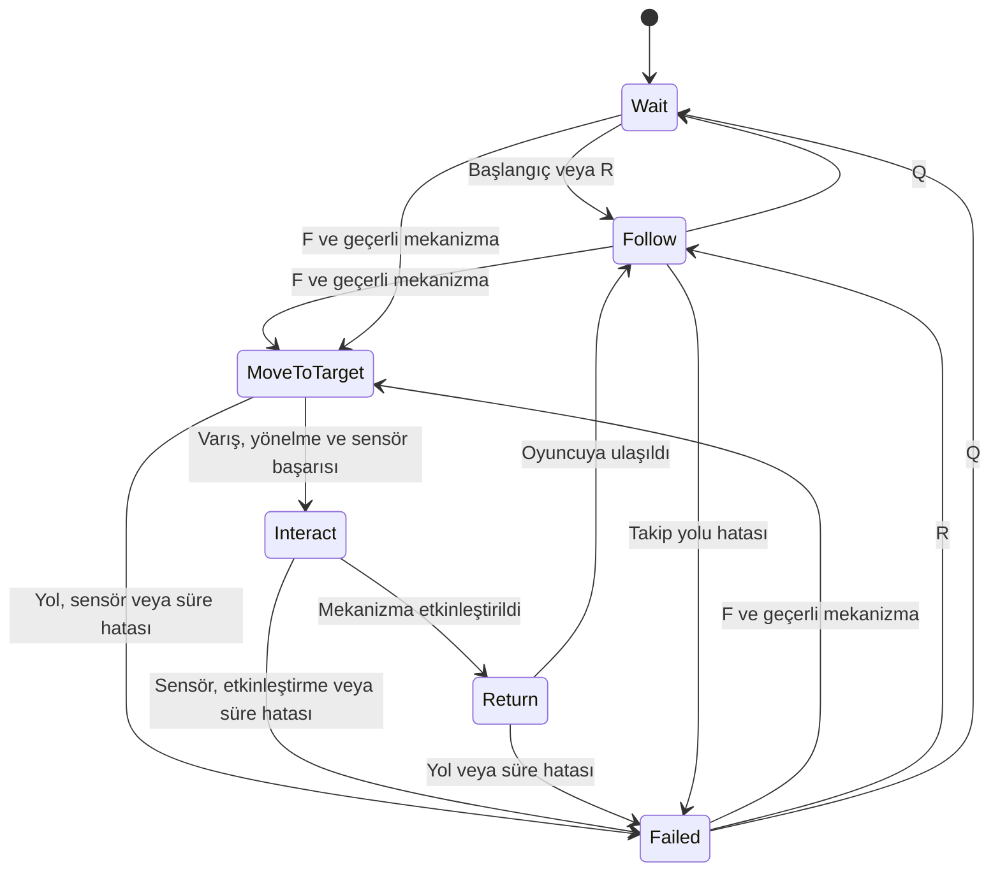

# Companion durum diyagramı

## Ek kurallar

- MoveToTarget, Interact ve Return sırasında ajan meşguldür.
- Meşgulken yeni F, Q ve R komutları görev akışını değiştirmez.
- Kullanılmış mekanizmaya verilen komut yeni görev başlatmaz.
- Geçersiz mekanizma ve kayıp zorunlu referanslar Failed oluşturabilir.
- Varış tek başına etkileşim başarısı değildir; sensör kontrolü gerekir.
- Görsel model, ajanın hareket ve algılama bileşenlerinden ayrıdır.